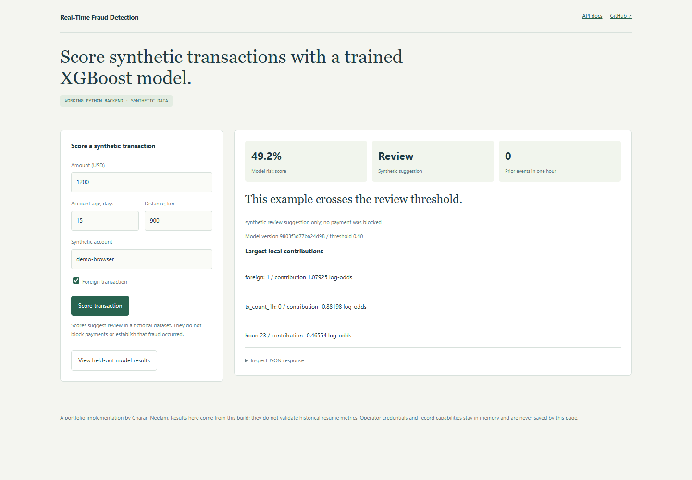

# Real-Time Fraud Detection System

[](https://github.com/charanneelam123-dot/realtime-fraud-detection/actions/workflows/test.yml)

**[Open the live app](https://realtime-fraud-detection-iosi.onrender.com)** · [API documentation](https://realtime-fraud-detection-iosi.onrender.com/docs)

A retry should not count as another transaction.

The application trains a real XGBoost classifier on seeded synthetic transactions.
It splits the sequence chronologically into training, validation, and test sets.
The threshold is selected on validation data using F2; the test set stays held out.
The model report includes precision, recall, PR AUC, ROC AUC, and a confusion matrix.
These are measured synthetic results, not the resume's historical performance claims.

The API computes one-hour account velocity before inserting the current event.
Transaction IDs are idempotent; a changed payload with the same ID conflicts.
Events arriving before the account's latest event are rejected explicitly. Local
model contributions are reported in log-odds and do not imply causal explanations.

An optional Kafka producer and Spark Structured Streaming adapter send synthetic
events to the same scoring API. The API owns canonical deduplication and feature
state. The adapter checkpoints batches and fails on malformed or overlarge batches
instead of silently dropping them. Kafka/Spark infrastructure has not been run
in this desktop environment. The HTTP scoring path and model training are tested.

Only demo-prefixed account and transaction IDs are accepted. Scores suggest a
review in a fictional dataset; they never block a payment. The model is not
calibrated or validated for real financial decisions.

## Run the actual application

Python 3.12+:

```bash
git clone https://github.com/charanneelam123-dot/realtime-fraud-detection.git
cd realtime-fraud-detection
python -m venv .venv
# Windows: .venv\Scripts\activate
# macOS/Linux: source .venv/bin/activate
pip install -r requirements.txt
uvicorn app:app --host 127.0.0.1 --port 8000
```

Open `http://127.0.0.1:8000` for the working interface and `/docs` for OpenAPI.
The browser calls the Python API; this is not a trace replay.



```mermaid
flowchart LR
    SyntheticEvents --> OrderedFeatures --> TrainValidationTest --> XGBoost
    Kafka --> Spark --> ScoringAPI
    HTTPEvents --> ScoringAPI
    XGBoost --> ScoringAPI --> IdempotentStore --> ReviewFlag
```

## API

- `GET /api/model`
- `POST /api/score`

Every app also exposes `GET /health` and `GET /metrics`. Successful responses have
an `X-Trace-ID`. OpenTelemetry spans are generated in process; no external collector
is configured by default. The optional observability configuration is under `ops/`.

## Operator settings

`DATA_DIR` selects the SQLite/artifact directory. It defaults to `runtime/` locally.
For model-backed routes, set `OPENAI_API_KEY`, `OPENAI_MODEL`, and a strong
`ADMIN_API_TOKEN` in the server environment. Supply the operator token in the UI
or the `X-Admin-Token` header. `.env.example` documents names; no file is loaded
automatically. Do not put keys in the repository or client source.

Model calls are opt-in and operator-protected. No paid live-model evaluation was
run during this build. Default examples work without model credentials.

## Checks and deployment

```bash
python -m unittest discover -s tests -v
docker build -t realtime-fraud-detection .
docker run --rm -p 8000:8000 -e PORT=8000 realtime-fraud-detection
```

The image runs as an unprivileged user. GitHub Actions tests Python 3.12/3.13 and
builds the Docker image. `render.yaml` declares one free web service with a health
check and a generated operator token. Actual deployment status is documented in
`docs/validation.md`; the presence of a Blueprint is not proof of deployment.

Free hosted instances use ephemeral storage. Restarts can lose records, vector
uploads, and checkpoints; keep the local data directory for persistence or add
an explicitly chosen persistent hosting plan. These projects do not claim
production availability, throughput, or multi-tenant isolation.

This is an independent portfolio implementation using synthetic data. It does
not reproduce an employer's code or establish the historical scale and accuracy
figures in a resume. MIT license.
